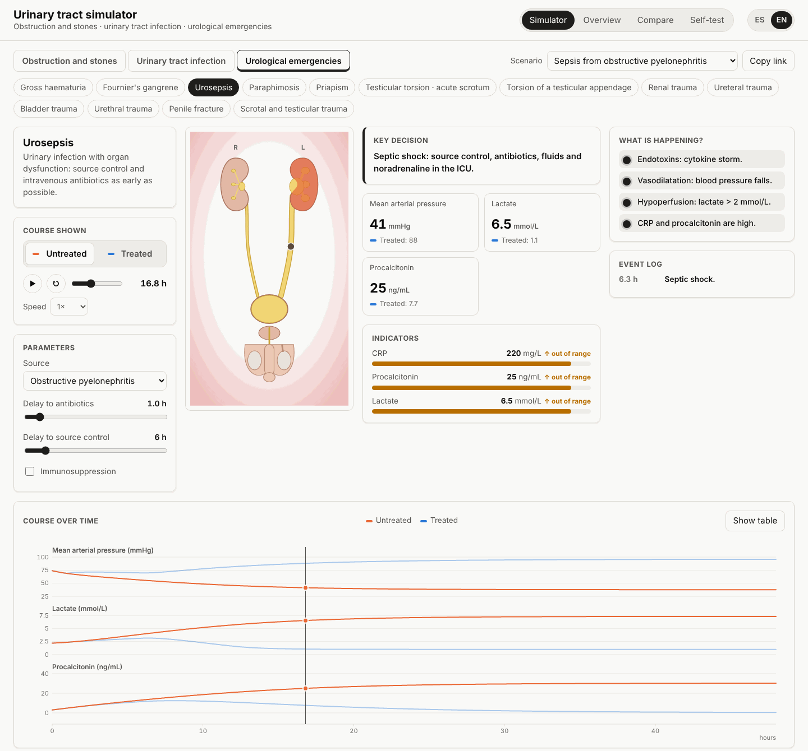

# Urinary tract simulator

**Obstruction and stones · urinary tract infection · urological emergencies**

An interactive teaching simulator of the urinary tract. Pick a condition, move its parameters and watch what happens over time on a live diagram of the tract, with the **untreated** course shown by default and the **treated** course one click away for comparison.

**Live demo:** https://ferasmed-dev.github.io/urinary-tract-simulator/ · English: https://ferasmed-dev.github.io/urinary-tract-simulator/?lang=en



> Teaching tool · not for clinical use.

## What it shows

26 conditions in three blocks, all driven by one shared, hand-drawn diagram of the urinary tract:

| Block | Conditions |
|---|---|
| **Obstruction and stones** | Renal colic (ureteral stone) · obstructive anuria · chronic hydronephrosis / PUJ obstruction · acute urinary retention · chronic retention (Guyon stages) · stone formation, composition, treatment and prevention |
| **Urinary tract infection** | Asymptomatic bacteriuria · acute cystitis · recurrent cystitis · acute pyelonephritis (uncomplicated, complicated, obstructive, emphysematous) · acute bacterial prostatitis · epididymo-orchitis · urethritis |
| **Urological emergencies** | Gross haematuria · Fournier's gangrene · urosepsis · paraphimosis · priapism (ischaemic / arterial) · testicular torsion and acute scrotum · torsion of a testicular appendage · renal, ureteral, bladder, urethral, penile and scrotal trauma |

For each condition:

- **Diagram:** the obstructed kidney dilates, the stone sits at its narrowing, bacteria climb, the testis twists and darkens, the bladder fills or leaks, and a sepsis glow appears when it becomes systemic.
- **Sliders and toggles** for the parameters that drive it (stone size and site, 24-h urine chemistry, delay to antibiotics or to source control, hours of torsion or priapism, AAST grade…).
- **Untreated vs treated** on the same time axis, plus a **key decision** panel showing what should be done at that moment.
- **"What is happening?"**: the mechanism step by step, lighting up as it happens, plus an **event log** (drainage, detorsion, debridement, post-obstructive diuresis…).
- **Indicators** with reference ranges (TWIST score, cavernosal blood gas, CRP / procalcitonin / lactate, supersaturation of each stone salt…).
- **Charts** (small multiples with hover) or a **data table**, an **entity card** (definition, what happens, diagnosis, treatment) and **reference values**.
- Three more views: **Overview** (every condition with its one-line summary), **Compare** (up to three conditions side by side, with the simulated outcome of each arm) and **Self-test** (18 short cases, each linked to the scenario that explains it).

Spanish and English, switchable at any time (`?lang=es|en`, remembered between visits). Light and dark themes follow the system setting. Works on mobile.

## Curriculum fit

For students and teachers at any Spanish medical faculty. The topic belongs to the shared core of the degree (Orden ECI/332/2008):

- **Module:** III — *Formación clínica humana* (urinary system pathology, infectious diseases, emergencies), with content from IV — *Procedimientos diagnósticos y terapéuticos* (imaging, urine microbiology, drainage procedures).
- **Typical subjects:** Urología; Nefrología; Patología médica y quirúrgica del aparato urinario / genitourinario; Enfermedades infecciosas; Urgencias; also Microbiología and Radiología, depending on the faculty.
- **MIR relevance:** high. Renal colic and drainage criteria, stone types and prevention, bacteriuria thresholds and when to treat asymptomatic bacteriuria, pyelonephritis, testicular torsion, priapism and urological trauma are recurring MIR topics.

Topic metadata for catalogues is in [`curriculum.json`](curriculum.json).

## For teachers

Every scenario has a link you can project or share. Add `&lang=en` for English and `&autoplay=0` to start paused.

| Scenario | Link |
|---|---|
| 4 mm distal stone (passes) | [`?preset=colicSmall`](https://ferasmed-dev.github.io/urinary-tract-simulator/?preset=colicSmall) |
| 8 mm stone at the iliac crossing | [`?preset=colicLarge`](https://ferasmed-dev.github.io/urinary-tract-simulator/?preset=colicLarge) |
| Colic with fever (pyonephrosis) | [`?preset=colicFever`](https://ferasmed-dev.github.io/urinary-tract-simulator/?preset=colicFever) |
| Colic in a solitary kidney | [`?preset=colicSolitary`](https://ferasmed-dev.github.io/urinary-tract-simulator/?preset=colicSolitary) |
| Anuria from pelvic cancer | [`?preset=anuriaPelvic`](https://ferasmed-dev.github.io/urinary-tract-simulator/?preset=anuriaPelvic) |
| Anuria with hyperkalaemia and anticoagulation | [`?preset=anuriaAnticoag`](https://ferasmed-dev.github.io/urinary-tract-simulator/?preset=anuriaAnticoag) |
| PUJ obstruction from a crossing vessel | [`?preset=upjPolar`](https://ferasmed-dev.github.io/urinary-tract-simulator/?preset=upjPolar) |
| Megacalycosis (no obstruction) | [`?preset=megacalycosis`](https://ferasmed-dev.github.io/urinary-tract-simulator/?preset=megacalycosis) |
| Acute retention from BPH | [`?preset=aurBph`](https://ferasmed-dev.github.io/urinary-tract-simulator/?preset=aurBph) |
| Chronic retention from BPH | [`?preset=chronicRetentionBph`](https://ferasmed-dev.github.io/urinary-tract-simulator/?preset=chronicRetentionBph) |
| Hypercalciuria: calcium oxalate | [`?preset=stoneHypercalciuria`](https://ferasmed-dev.github.io/urinary-tract-simulator/?preset=stoneHypercalciuria) |
| Uric acid in acid urine | [`?preset=stoneUric`](https://ferasmed-dev.github.io/urinary-tract-simulator/?preset=stoneUric) |
| Struvite from Proteus | [`?preset=stoneStruvite`](https://ferasmed-dev.github.io/urinary-tract-simulator/?preset=stoneStruvite) |
| Cystinuria | [`?preset=stoneCystine`](https://ferasmed-dev.github.io/urinary-tract-simulator/?preset=stoneCystine) |
| Asymptomatic bacteriuria in pregnancy | [`?preset=baPregnancy`](https://ferasmed-dev.github.io/urinary-tract-simulator/?preset=baPregnancy) |
| Bacteriuria in a catheterised patient | [`?preset=baCatheter`](https://ferasmed-dev.github.io/urinary-tract-simulator/?preset=baCatheter) |
| Cystitis: fosfomycin | [`?preset=cystitisFosfomycin`](https://ferasmed-dev.github.io/urinary-tract-simulator/?preset=cystitisFosfomycin) |
| Cystitis: empirical co-trimoxazole | [`?preset=cystitisCotrimoxazole`](https://ferasmed-dev.github.io/urinary-tract-simulator/?preset=cystitisCotrimoxazole) |
| Recurrent cystitis, premenopausal | [`?preset=recurrentYoung`](https://ferasmed-dev.github.io/urinary-tract-simulator/?preset=recurrentYoung) |
| Recurrent cystitis, post-menopausal | [`?preset=recurrentPostmenopausal`](https://ferasmed-dev.github.io/urinary-tract-simulator/?preset=recurrentPostmenopausal) |
| Uncomplicated pyelonephritis | [`?preset=pnaUncomplicated`](https://ferasmed-dev.github.io/urinary-tract-simulator/?preset=pnaUncomplicated) |
| Obstructive pyelonephritis | [`?preset=pnaObstructive`](https://ferasmed-dev.github.io/urinary-tract-simulator/?preset=pnaObstructive) |
| Emphysematous pyelonephritis | [`?preset=pnaEmphysematous`](https://ferasmed-dev.github.io/urinary-tract-simulator/?preset=pnaEmphysematous) |
| Prostatitis: 7-day course (relapses) | [`?preset=prostatitisShort`](https://ferasmed-dev.github.io/urinary-tract-simulator/?preset=prostatitisShort) |
| Epididymitis at 24 / at 62 | [`?preset=epididymitisYoung`](https://ferasmed-dev.github.io/urinary-tract-simulator/?preset=epididymitisYoung) · [`?preset=epididymitisOlder`](https://ferasmed-dev.github.io/urinary-tract-simulator/?preset=epididymitisOlder) |
| Gonococcal urethritis / chlamydia in a woman | [`?preset=urethritisGonococcal`](https://ferasmed-dev.github.io/urinary-tract-simulator/?preset=urethritisGonococcal) · [`?preset=urethritisChlamydiaWoman`](https://ferasmed-dev.github.io/urinary-tract-simulator/?preset=urethritisChlamydiaWoman) |
| Haematuria with clots | [`?preset=hematuriaClots`](https://ferasmed-dev.github.io/urinary-tract-simulator/?preset=hematuriaClots) |
| Fournier's gangrene | [`?preset=fournier`](https://ferasmed-dev.github.io/urinary-tract-simulator/?preset=fournier) |
| Sepsis from obstructive pyelonephritis | [`?preset=sepsisObstructive`](https://ferasmed-dev.github.io/urinary-tract-simulator/?preset=sepsisObstructive) |
| Paraphimosis after catheterisation | [`?preset=paraphimosisCatheter`](https://ferasmed-dev.github.io/urinary-tract-simulator/?preset=paraphimosisCatheter) |
| Ischaemic priapism treated at 6 h / 40 h | [`?preset=priapismIschemic6h`](https://ferasmed-dev.github.io/urinary-tract-simulator/?preset=priapismIschemic6h) · [`?preset=priapismIschemic40h`](https://ferasmed-dev.github.io/urinary-tract-simulator/?preset=priapismIschemic40h) |
| Post-traumatic arterial priapism | [`?preset=priapismArterial`](https://ferasmed-dev.github.io/urinary-tract-simulator/?preset=priapismArterial) |
| Testicular torsion at 4 h / 24 h | [`?preset=torsionEarly`](https://ferasmed-dev.github.io/urinary-tract-simulator/?preset=torsionEarly) · [`?preset=torsionLate`](https://ferasmed-dev.github.io/urinary-tract-simulator/?preset=torsionLate) |
| Torsion of a testicular appendage | [`?preset=appendixTorsion`](https://ferasmed-dev.github.io/urinary-tract-simulator/?preset=appendixTorsion) |
| Renal injury grade III / grade V | [`?preset=renalGrade3`](https://ferasmed-dev.github.io/urinary-tract-simulator/?preset=renalGrade3) · [`?preset=renalGrade5`](https://ferasmed-dev.github.io/urinary-tract-simulator/?preset=renalGrade5) |
| Ureteral injury after hysterectomy | [`?preset=ureterHysterectomy`](https://ferasmed-dev.github.io/urinary-tract-simulator/?preset=ureterHysterectomy) |
| Intraperitoneal / extraperitoneal bladder rupture | [`?preset=bladderIntra`](https://ferasmed-dev.github.io/urinary-tract-simulator/?preset=bladderIntra) · [`?preset=bladderExtra`](https://ferasmed-dev.github.io/urinary-tract-simulator/?preset=bladderExtra) |
| Posterior urethral rupture | [`?preset=urethraPosterior`](https://ferasmed-dev.github.io/urinary-tract-simulator/?preset=urethraPosterior) |
| Penile fracture | [`?preset=penileFracture`](https://ferasmed-dev.github.io/urinary-tract-simulator/?preset=penileFracture) |
| Testicular rupture | [`?preset=testicularRupture`](https://ferasmed-dev.github.io/urinary-tract-simulator/?preset=testicularRupture) |

Other links: `?view=overview`, `?view=compare`, `?view=quiz`. Any free scenario can be shared with **Copy link**, which encodes the condition and every changed parameter.

## Presets: expected results

End of the simulation, untreated → treated. These are checked automatically in `tests/model.test.js`.

| Preset | What to look for |
|---|---|
| `colicSmall` | 4 mm distal stone passes on its own (≈ day 14) in both arms; kidney function recovers. |
| `colicLarge` | Untreated: filtration of the obstructed kidney falls to ≈ 0% after 6 weeks of complete obstruction (irreversible after day 7). Treated: drainage on day 2, ureteroscopy on day 7, 100% recovery. |
| `colicFever` | Untreated: sepsis on day 2, temperature > 39 °C. Treated: drainage within 6 h, afebrile by day 2. |
| `colicSolitary` | Untreated: anuria, creatinine > 4 mg/dL by day 4. Treated: drainage at 6 h, creatinine back to 0.9 mg/dL. |
| `anuriaPelvic` | Untreated: K⁺ > 6.5 mEq/L on day 2, creatinine 8.0 mg/dL by day 7. Treated: post-obstructive diuresis > 200 mL/h, creatinine 0.9 mg/dL. |
| `anuriaAnticoag` | Treated: haemodialysis first, drainage one day later. |
| `upjPolar` | Split function 42% → 0.6% at 10 years untreated; pyeloplasty at year 2 keeps it at ≈ 34%. |
| `megacalycosis` | Dilated but stable: split function stays at 42%. |
| `aurBph` | Bladder > 1,500 mL untreated; catheter at 2 h empties it. |
| `chronicRetentionBph` | Guyon stage 2 at ≈ year 4, stage 3 at ≈ year 6.4; residual 673 mL untreated vs 78 mL after treatment at year 7. |
| `stoneHypercalciuria` | Calcium oxalate stone grows to ≈ 10 mm in 3 years; prevention from month 6 stops it at ≈ 1.6 mm. |
| `stoneUric` | Uric acid stone 13 mm untreated; alkalinisation dissolves it by month 7. |
| `stoneStruvite` | Struvite staghorn > 20 mm untreated; antibiotics + acidification stop growth (the stone still needs complete removal). |
| `stoneCystine` | Cystine stone; high fluids + alkalinisation + tiopronin stop growth. |
| `baPregnancy` | Risk of pyelonephritis ≈ 23% untreated vs ≈ 5.5% treated over 60 days. |
| `baCatheter` | Same risk (≈ 9%) with or without treatment; recolonisation after the course. |
| `cystitisFosfomycin` | 50% resolve by day 7 untreated; < 12% still symptomatic on day 3 with fosfomycin. |
| `cystitisCotrimoxazole` | ≈ 28% still symptomatic on day 3 (≈ 30% resistance): culture and change. |
| `recurrentYoung` | 3.2 episodes/year untreated (meets the recurrence criterion) vs 0.6 with post-coital prophylaxis, at the cost of 156 antibiotic days a year. |
| `recurrentPostmenopausal` | 1.9 → 0.8 episodes/year with vaginal oestriol. |
| `pnaUncomplicated` | Afebrile at ≈ 1.4 days on antibiotics; no CT needed. |
| `pnaObstructive` | Cumulative sepsis risk ≈ 100% untreated vs ≈ 14% with drainage at 12 h. |
| `pnaEmphysematous` | ≈ 100% vs ≈ 25% with antibiotics + percutaneous drainage. |
| `prostatitisShort` | 7 days of antibiotics: relapse into chronic bacterial prostatitis on ≈ day 20. |
| `epididymitisYoung` / `Older` | STI organisms under 35, enterobacteria from 35; pain gone within a week of treatment. |
| `urethritisGonococcal` | Purulent discharge; it falls by about three-quarters within 36 h of ceftriaxone + azithromycin. |
| `urethritisChlamydiaWoman` | Almost silent, but complication risk rises to ≈ 7.6% at 3 weeks untreated. |
| `hematuriaClots` | Clot retention at 6 h, bladder 1,400 mL untreated; evacuation + irrigation keep Hb ≈ 11 g/dL. |
| `fournier` | Untreated necrosis 100% and mortality 96%; debridement at 8 h → mortality ≈ 9%. |
| `sepsisObstructive` | Untreated: septic shock at ≈ 6 h, MAP 38 mmHg. Treated: MAP 96 mmHg, procalcitonin 0.5 ng/mL. |
| `paraphimosisCatheter` | Untreated: glans necrosis from ≈ 31 h. Treated at 3 h: manual reduction succeeds. |
| `priapismIschemic6h` / `40h` | Erectile-dysfunction risk ≈ 3% if treated at 6 h, ≈ 95% if treated at 40 h (distal shunt). |
| `priapismArterial` | Normal arterial gas, no ischaemia; embolisation at 36 h. |
| `torsionEarly` / `Late` | Testicular survival ≈ 95% with detorsion at 4 h (orchidopexy) vs ≈ 40% at 24 h (orchiectomy). |
| `appendixTorsion` | Self-limiting pain over 1–2 weeks. |
| `renalGrade3` | Hb stays at 13.4 g/dL: observation. |
| `renalGrade5` | Untreated: exsanguination; surgery at 2 h restores MAP to ≈ 76 mmHg. |
| `ureterHysterectomy` | Untreated urinoma > 1.4 L, fever and fistula on day 7; distal repair (psoas hitch reimplantation). |
| `bladderIntra` | Untreated creatinine rises to 6.5 mg/dL (urine reabsorbed from the peritoneum); surgical repair. |
| `bladderExtra` | Catheter drainage, cystogram on day 10. |
| `urethraPosterior` | Suprapubic cystostomy, delayed urethroplasty at 3 months; lumen 0% → 95%. |
| `penileFracture` | Sequelae ≈ 33% with conservative management vs ≈ 5% with repair at 8 h. |
| `testicularRupture` | Testis kept in ≈ 35% without exploration vs ≈ 92% with exploration at 12 h. |

## How the model works

Each condition is a small time-stepped model in `src/model/` (pure functions, no DOM): `init(params)` → state, `step(state, t, dt)` → next state with discrete events, plus the mechanism steps active at each moment and a schematic description for the diagram. Every condition is run twice, untreated and treated, with the same parameters.

Key equations:

- **Creatinine:** `dCr/dt = G₀ − k·G·Cr`, with production set so that anuria raises creatinine by ≈ 1.2 mg/dL/day and steady state `Cr = 0.9 / G` (G = GFR fraction).
- **Potassium in anuria:** `dK/dt = 0.5·(1 − u) − 0.8·u·(K − 4.2)` mEq/L/day (u = urine output fraction).
- **Irreversible loss after complete obstruction:** 0 up to day 7, 30% at 2 weeks, 70% at 4 weeks, 100% at 6 weeks (interpolated).
- **Stone passage:** logistic in size, `P = 1 / (1 + e^{0.95·(size − s₅₀)})`, s₅₀ = 6 mm at the iliac crossing (5 at the PUJ, 7 at the VUJ); alpha-blocker: ×1.45 for stones > 5 mm.
- **Supersaturation (24-h urine):** calcium oxalate ∝ [Ca]·[Ox]·citrate inhibition; calcium phosphate ∝ [Ca]·10^(pH−6.6); uric acid ∝ [UA]·undissociated fraction (pKa 5.5); cystine ∝ [Cys]/solubility (doubling every 0.5 pH unit above 7); struvite only with urease. Stones grow when the index exceeds 1.
- **Cystitis:** fraction still symptomatic = `(1 − r)·e^{−(t−0.5)/1} + r·e^{−t/10.1}` with antibiotics (r = local resistance), `e^{−t/10.1}` without (50% at day 7).
- **Testicular survival:** interpolation of the published survival by hours of torsion, with effective time scaled by √(degrees / 720).
- **Ischaemic priapism damage:** logistic in hours, centred at 24 h.

### Parameters and constants

| Value | Used for | Basis |
|---|---|---|
| Baseline creatinine 0.9 mg/dL; rise ≈ 1.2 mg/dL/day in anuria | Obstruction, anuria | Physiology (typical anuric rise 1–1.5 mg/dL/day) |
| Recovery after complete obstruction: full ≤ 1 week, ≈ 70% at 2 weeks, ≈ 30% at 4, none at 6 | Colic, anuria | Experimental data (Vaughan & Gillenwater) |
| Ureteral stone passage: 2–4 mm ≈ 95%, ≤ 5 mm ≈ 68–80%, 5–10 mm ≈ 47% | Colic | AUA/EAU ureteral stone guideline meta-analysis; CT cohorts |
| Alpha-blocker RR 1.45 for stones > 5 mm, no effect ≤ 5 mm | Colic | Cochrane review 2018 |
| Time to passage ≈ 8 / 12 / 22 days (≤ 2, 2–4, 4–6 mm) | Colic | Miller & Kane |
| Drainage criteria: solitary kidney, infection, refractory pain, persistent complete obstruction | Colic | Guidelines |
| Post-obstructive diuresis > 200 mL/h | Anuria | Clinical definition |
| Split function ≥ 20% worth saving, < 10% nephrectomy | PUJ obstruction | Clinical convention · **Model** thresholds |
| Residual > 100 mL significant; distension > 400 mL | Chronic retention | **Model** thresholds |
| Ca > 250–300, oxalate > 40, uric acid > 750 (♀) / 800 (♂), cystine > 250, citrate < 320 mg/24 h | Stones | Metabolic work-up thresholds |
| < 10 mm SWL/fURS · 10–20 mm SWL or endourology · > 20 mm PCNL | Stones | EAU / AUA urolithiasis guidelines |
| Thresholds 10² / 10³ / 10⁴ / 10⁵ cfu/mL by sample; ≥ 3 organisms = contamination | Infection | EAU urological infections |
| Nitrite + esterase sensitivity 71%, specificity 83% | Infection | Diagnostic accuracy data |
| Asymptomatic bacteriuria in pregnancy: pyelonephritis ≈ 25% untreated vs ≈ 6% treated | Bacteriuria | IDSA 2019; Cochrane 2019 (RR ≈ 0.24) |
| E. coli resistance: fosfomycin/nitrofurantoin ≈ 4%, cefuroxime ≈ 10%, amoxicillin-clavulanate ≈ 20%, co-trimoxazole ≈ 30%, ciprofloxacin ≈ 28% | Cystitis | Order of magnitude of Spanish community data · **Model** |
| Prevention RR: antibiotic 0.15–0.2, oestriol 0.4, methenamine 0.3, cranberry 0.74, D-mannose ≈ 1 | Recurrent cystitis | Meta-analyses (rounded) · **Model** |
| Acute prostatitis: 2–4 weeks; reservoir cleared after 14 days of effective antibiotic | Prostatitis | EAU · **Model** |
| Gonococcus: ceftriaxone 1 g IM + azithromycin 2 g | Urethritis | IUSTI 2020 European guideline |
| Sepsis markers CRP > 60 mg/L, procalcitonin > 2 ng/mL, lactate > 2 mmol/L; MAP ≥ 65 mmHg | Sepsis | Sepsis-3; Surviving Sepsis Campaign 2021 |
| ≈ 7.6% mortality per hour of hypotension before antibiotics | Sepsis | Kumar et al. 2006 · **Model** |
| Cavernosal gas: ischaemic pO₂ < 30, pCO₂ > 60, pH < 7.25 | Priapism | AUA/SMSNA and EAU |
| Testicular survival 97% (0–6 h), 79% (7–12 h), 61% (13–18 h), 43% (19–24 h), 24% (25–48 h), 7% (> 48 h) | Torsion | Mellick et al. 2019 |
| TWIST: ≤ 2 low, 3–4 intermediate, ≥ 5 high | Torsion | Barbosa et al. 2013 |
| AAST grades I–V; bleeding rates by grade | Renal trauma | AAST scale · bleeding rates **Model** |
| Fournier necrosis spread, mortality curve; paraphimosis oedema; urinoma volumes; complication risks after penile/testicular trauma | Emergencies | **Model** (shape guided by the literature) |

Values tagged **Model** in the app are tuning choices or proxies, not exact clinical figures.

### Known simplifications

- Each run is deterministic and shows the **expected** course; spontaneous stone passage happens on the expected day when its probability is ≥ 50% and never otherwise.
- Population outcomes (share still symptomatic, cumulative risk, mortality) and single-patient physiology (creatinine, temperature) are mixed on purpose, depending on what each condition teaches best.
- The affected side is always the patient's left (drawn on the viewer's right).
- Doses and regimens are summarised for teaching; check current local guidance before any real decision.

## Layout

```
index.html
src/model.js            public API: entities, presets, key decisions, model tags
src/model/core.js       shared engine (run, runBoth, sanitize…)
src/model/obstruction.js
src/model/infection.js
src/model/emergencies.js
src/i18n.js             Spanish + English strings, self-test questions
src/ui.js               DOM, playback, views, deep links, window.__sim hook
src/tract.js            SVG diagram of the urinary tract
src/charts.js           dependency-free SVG charts
src/styles.css
tests/model.test.js     model behaviour and every preset
tests/i18n.test.js      every string the model can emit exists in both languages
curriculum.json
```

## Run locally

No build step and no dependencies.

```bash
python3 -m http.server 8000
# open http://localhost:8000
```

## Tests

```bash
npm test     # node --test (Node 18+)
```

The tests check every condition in both arms (finite, bounded values; extremes of every slider), the key mechanisms (passage vs size, irreversible obstruction, supersaturation vs pH, bacteriuria thresholds, torsion survival, priapism gas classification…), every preset's expected behaviour and the completeness of both languages. GitHub Actions runs them on every push.

## Deploy (GitHub Pages)

1. Create an empty public repository named `urinary-tract-simulator`.
2. Push these files to `main` (with `index.html` at the root).
3. Settings → Pages → Deploy from a branch → `main` / `(root)`.
4. After 1–2 minutes the site is live at https://ferasmed-dev.github.io/urinary-tract-simulator/.

## References

- EAU Guidelines: Urolithiasis; Urological Infections; Urological Trauma; Sexual and Reproductive Health (priapism, penile fracture); Paediatric Urology (acute scrotum). European Association of Urology, current editions.
- Preminger GM, et al. 2007 guideline for the management of ureteral calculi (AUA/EAU). J Urol. 2007;178:2418–34.
- Miller OF, Kane CJ. Time to stone passage for observed ureteral calculi. J Urol. 1999;162:688–90.
- Campschroer T, et al. Alpha-blockers as medical expulsive therapy for ureteral stones. Cochrane Database Syst Rev. 2018.
- Vaughan ED Jr, Gillenwater JY. Recovery following complete chronic unilateral ureteral occlusion. J Urol. 1971;106:27–35.
- Nicolle LE, et al. Clinical practice guideline for the management of asymptomatic bacteriuria: 2019 update by the IDSA. Clin Infect Dis. 2019;68:e83–e110.
- Smaill FM, Vazquez JC. Antibiotics for asymptomatic bacteriuria in pregnancy. Cochrane Database Syst Rev. 2019.
- European Medicines Agency. Restrictions on the use of quinolone and fluoroquinolone antibiotics (2018).
- Williams G, et al. Cranberries for preventing urinary tract infections. Cochrane Database Syst Rev. 2023.
- Unemo M, et al. 2020 European guideline for the diagnosis and treatment of gonorrhoea in adults. Int J STD AIDS. 2020.
- Singer M, et al. The Third International Consensus Definitions for Sepsis and Septic Shock (Sepsis-3). JAMA. 2016;315:801–10.
- Evans L, et al. Surviving Sepsis Campaign: international guidelines 2021. Crit Care Med. 2021;49:e1063–e1143.
- Kumar A, et al. Duration of hypotension before effective antimicrobial therapy is the critical determinant of survival in septic shock. Crit Care Med. 2006;34:1589–96.
- Bivalacqua TJ, et al. AUA/SMSNA guideline on the diagnosis and management of priapism. J Urol. 2022.
- Spycher MA, Hauri D. The ultrastructure of the erectile tissue in priapism. J Urol. 1986;135:142–7.
- Mellick LB, et al. A systematic review of testicle survival time after a torsion event. Pediatr Emerg Care. 2019;35:821–5.
- Barbosa JA, et al. Development and initial validation of a scoring system to diagnose testicular torsion (TWIST). J Urol. 2013;189:1859–64.
- Kozar RA, et al. Organ injury scaling 2018 update: spleen, liver, and kidney. J Trauma Acute Care Surg. 2018;85:1119–22.

## Licence

MIT © 2026 Feras Elhissi. See [LICENSE](LICENSE).
